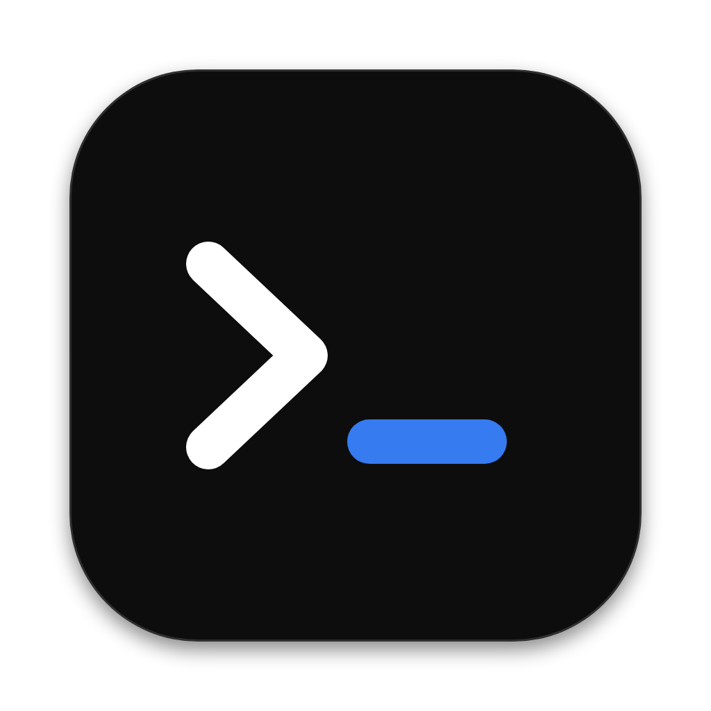

# privatewebchat

**Private, invite-only chat for you and your friends, on Mac and Windows.**

 

## What it is

A small desktop chat app for a closed group of friends. You can't sign up: you need an invite code to get in. Once you're in, there's:

- **General**, a chat for everyone
- **Friends**, added by username
- **Direct messages** with friends, deleted automatically after 24 hours
- **Group chats** with any of your friends
- **Desktop notifications** for DMs, groups and friend requests
- **A PIN lock** every time you open the app
- **A black-out key** that instantly turns the window black, until you type your PIN
- **A wipe PIN** that erases everything on your computer

## Getting in

1. Download the app from [**Releases**](../../releases): `privatewebchat-mac.zip` or `privatewebchat.exe`.
2. Open it. The first time, your computer will warn that the app isn't from an identified developer:
   - **Mac:** right-click the app → **Open** → **Open**
   - **Windows:** **More info** → **Run anyway**
3. Paste your invite code, then pick a username and a PIN.

## End-to-end encryption

Every message is encrypted on your computer before it's sent, and only the people it's meant for can decrypt it. The server just passes along scrambled data. It can see that a message went from one person to another, but not what it says, what your groups are called, or who's on your friends list.

Each message gets its own key, so no single message key unlocks a whole conversation. Everything the app saves on your computer is also encrypted with your PIN, and erased for good if you use the wipe PIN.

## Themes

Change the look in **Settings → Appearance**. The default is **Kali**: black, white and Kali blue.

<table>
<tr>
<td width="33%"> <b>Matrix</b></td>
<td width="33%"> <b>Amber</b></td>
<td width="33%"> <b>Midnight</b></td>
</tr>
</table>

## FAQ

**How do I get an invite code?** Ask the developer. Each code works for one person.

**Can I change my username?** No. Usernames are permanent, so everyone knows who they're talking to.

**Do I have to be friends with someone to talk to them?** Not in General. DMs and group chats are for friends only.

**Can I keep a DM longer than 24 hours?** No. That's on purpose, for privacy. General and group chats are kept.

**What if I forget my PIN?** It can't be reset, because it's what encrypts your data. Ask the developer for a new invite code.

**Why is the download so small?** The app uses the web view your computer already has, instead of bundling a whole browser.
