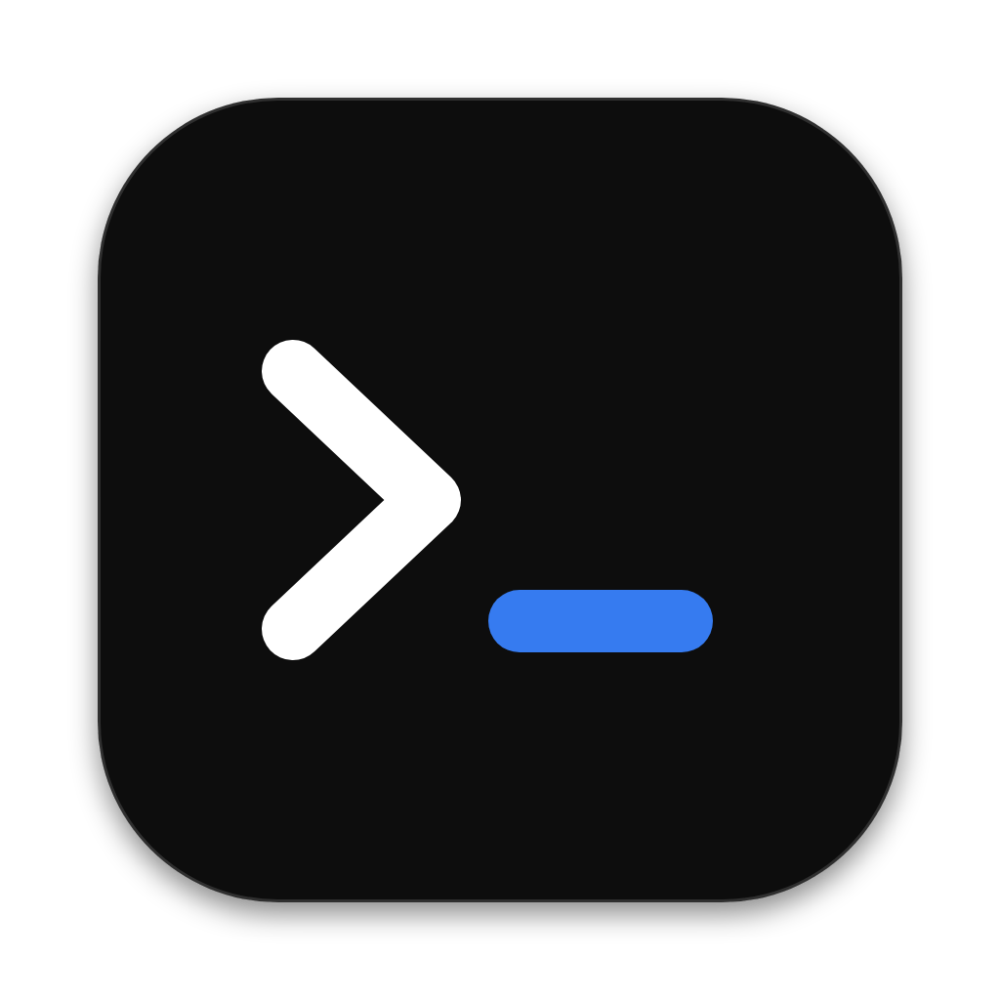
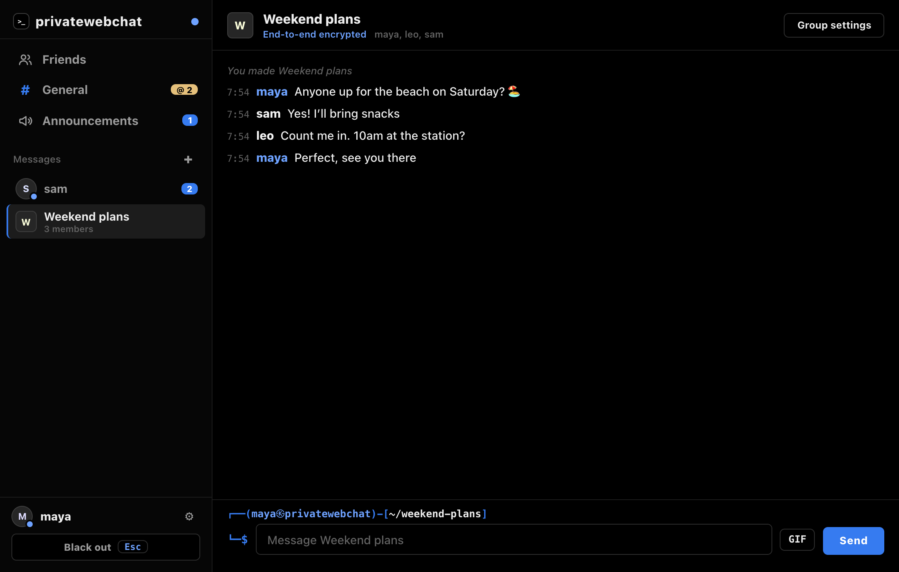
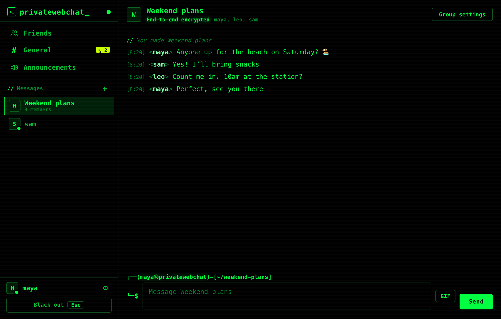
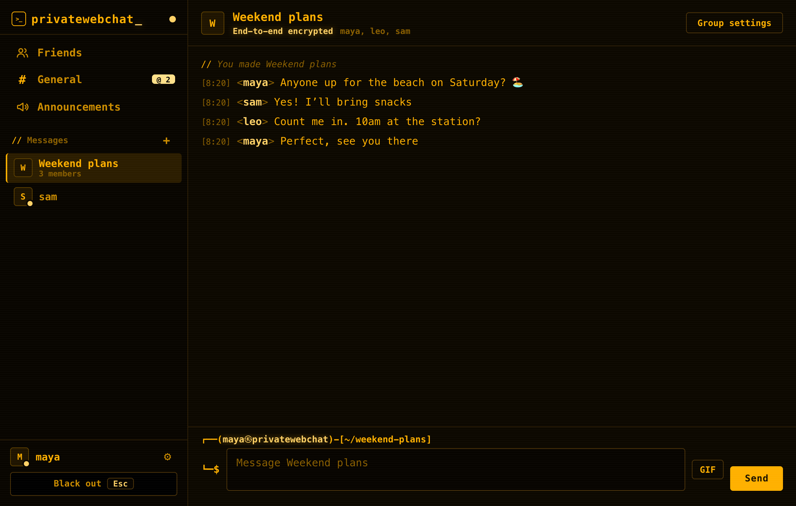
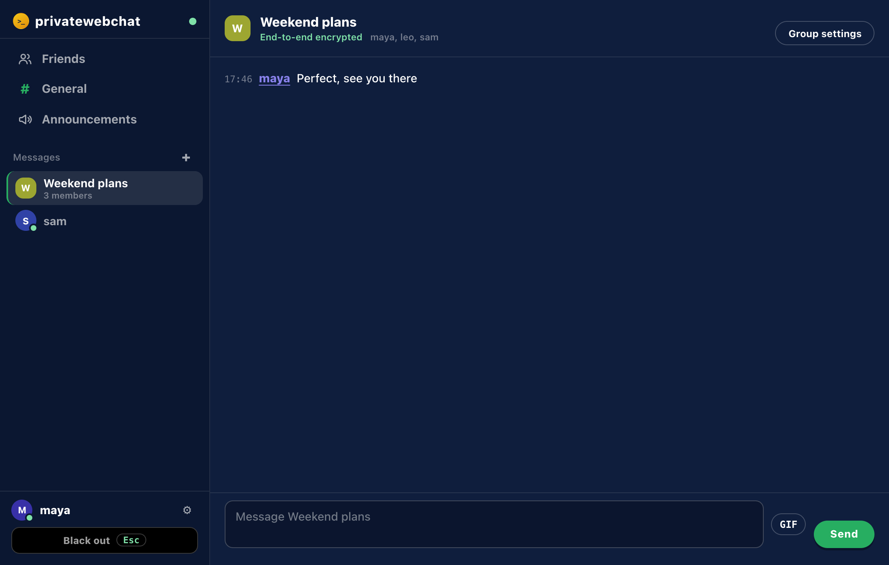

# privatewebchat

**Private, invite-only chat for you and your friends, on Mac (Apple Silicon) and Windows.**

 

## What it is

A small desktop chat app for a closed group of friends. You can't sign up: you need an invite code to get in. Once you're in, there's:

- **General**, a chat for everyone
- **Friends**, added by username
- **Direct messages** with friends (remove a friend or close a conversation whenever you like)
- **Group chats** with any of your friends
- **Announcements**, news and patch notes from the developer (only the developer can post)
- **Mentions**: type **@** and a name to ping someone; they get a notification, even in General
- **Replies**: hover over a message and click **Reply** to quote it
- **ASCII GIFs**: animated ASCII art from the **GIF** button, like a cat, a rocket or a dancing stick figure
- **Automatic updates**: when privatewebchat opens and there's a new version, it installs it and shows what's new
- **Desktop notifications** for DMs, groups, mentions, announcements and friend requests, even with the window closed: privatewebchat keeps running in the system tray (Windows) or the menu bar and Dock (Mac) until you choose Quit
- **Opens when you log in** (turn it off in **Settings → Startup**). Opening it again while it's running brings back the window that's already open
- **A PIN lock** every time you open the app
- **A black-out key** that instantly turns the window black, until you type your PIN
- **A wipe PIN** that erases everything on your computer
- **Messages that last 24 hours**, then they're deleted from everyone's computer. Server restarts don't matter

## Getting in

1. Download the app from [**Releases**](../../releases/latest):

   | | Download |
   |---|---|
   | **Windows 10 / 11** | [`privatewebchat.exe`](../../releases/latest/download/privatewebchat.exe) |
   | **Mac (Apple Silicon, macOS 12+)** | [`privatewebchat.dmg`](../../releases/latest/download/privatewebchat.dmg) |

   You can also download both from [unblockedarcade.org](https://unblockedarcade.org) (the EduArcade site). Intel Macs aren't supported.
2. Open it. On Mac, open the .dmg and drag privatewebchat into Applications. The first time, your computer will warn that the app isn't from an identified developer:
   - **Mac:** right-click the app → **Open** → **Open**. If there's no Open button, go to **System Settings → Privacy & Security** and click **Open Anyway**
   - **Windows:** **More info** → **Run anyway**
3. Type the 12-digit code you were told, or paste your invite code (it starts with `PWC2.`, or `PWC1.` for the longer kind), then pick a username and a PIN.

### Checking your download

Every release lists a `SHA256SUMS.txt` with a checksum for each file. If your file's checksum matches, it's exactly the file that was published:

- **Windows** (PowerShell): `Get-FileHash privatewebchat.exe`
- **Mac** (Terminal): `shasum -a 256 privatewebchat.dmg`

The app is built from the code in this repository: `app/build-windows.sh` and `app/build-mac.sh`.

## Updates

Every time privatewebchat opens, it checks this repository's [Releases](../../releases/latest) for a newer version. If there is one, it shows the patch notes, downloads the file for your computer, checks it against the release's `SHA256SUMS.txt`, installs it and opens again. If you're offline or anything goes wrong, it just opens as usual and tries again next time.

Versions 1.1.4 and older can't update themselves, and no longer work once 1.1.5 is out: they show a banner saying where to download the new version. Install it once by hand (you keep your username, PIN and friends, so no invite code is needed) and it takes care of itself after that.

**Publishing an update** (developer): bump the version in `app/ui/config.js`, `app/mac/Info.plist`, `app/win/app.rc` and `app/build-mac.sh` (`node tests/version.test.js` checks they match), write the patch notes in `docs/releases/vX.Y.Z.md`, then push a tag: `git tag vX.Y.Z && git push origin vX.Y.Z`. The patch notes are shown while the app updates, and posted in everyone's Announcements. To put a release on the EduArcade site too: `sh tools/site-downloads.sh ~/unblockedarcade`, then commit and push the site (the apps update themselves, so the site's copy only needs refreshing now and then).

## End-to-end encryption

Every message is encrypted on your computer before it's sent, and only the people it's meant for can decrypt it. The server just passes along scrambled data. It can see that a message went from one person to another, but not what it says, what your groups are called, or who's on your friends list.

Each message gets its own key, so no single message key unlocks a whole conversation. Everything the app saves on your computer is also encrypted with your PIN, and erased for good if you use the wipe PIN.

## Messages last 24 hours

Every message is deleted from everyone's computer 24 hours after it was sent, in General, group chats and DMs alike. The server never stores messages: it only passes them along, and if it restarts (an update, or the free hosting going to sleep after a quiet spell) before one is delivered, the sender's app sends it again once the server is back.

If you send a message while the server is asleep, it shows **Connecting…**, the app wakes the server up (that can take up to a minute), and your message goes out as soon as it's back.

## Themes

Change the look in **Settings → Appearance**. The default is **Kali**: black, white and Kali blue. **Kali Light** is the same on white.

<table>
<tr>
<td width="33%"> <b>Matrix</b></td>
<td width="33%"> <b>Amber</b></td>
<td width="33%"> <b>Midnight</b></td>
</tr>
</table>

## FAQ

**How do I get an invite code?** Ask the developer. Each code works for one person. It can be a code to paste, or 12 digits they read out to you.

**How do spoken codes work?** The 12 digits stand for an ordinary invite code, which the server keeps encrypted with a key that only those digits give. Turning digits into that key is slow on purpose, so guessing a code would take years of computing, and spoken codes expire after 7 days. Someone in the network has to have privatewebchat open now and then for them to survive server restarts (the developer's own app counts). The developer makes them with `node tools/owner.js spoken`, or in **Settings → Owner**.

**I'm the developer. How do I get in?** The same way as everyone else: make yourself an invite code with `node tools/owner.js invite` and paste it into the app. It prints short codes (`PWC2.`) once the newest release reads them (1.1.6 and newer), and long ones (`PWC1.`) before that; `--long` always gives a long one, which every version reads. The owner key (`node tools/owner.js key`, the one starting with `B`) only goes in the server's settings on Render, and it isn't an invite code. Once you're in on the computer that holds the owner key, **Settings → Owner** makes invite codes for you, and you can post in **Announcements**.

**Are announcements encrypted?** No. Everyone in the network reads them, so they're signed with the owner key instead: nobody else, including the server, can post one or change one. Unlike messages, they don't expire after 24 hours.

**Can I change my username?** No. Usernames are permanent, so everyone knows who they're talking to.

**Do I have to be friends with someone to talk to them?** Not in General. DMs and group chats are for friends only.

**Can I keep messages longer than 24 hours?** No. That's on purpose, for privacy.

**Can I hide from the list of everyone in the network?** Yes: **Settings → Privacy → Don't list me**. People can still add you by typing your exact username.

**How do I quit?** Closing the window keeps privatewebchat running so notifications still arrive. When you come back, it asks for your PIN. To quit for real, use the tray icon's menu on Windows, or **Quit** in the menu bar icon or Cmd+Q on Mac.

**What if I forget my PIN?** It can't be reset, because it's what encrypts your data. Ask the developer for a new invite code.

**Why is the Mac download so much bigger?** The Mac app has Chromium built in (the engine behind Google Chrome), so it runs the same way on every Mac. On Windows the app uses Microsoft's WebView2, which is also Chromium and is already part of Windows, so the .exe stays small.
