<div align="center">


# privatewebchat

**Private, end-to-end encrypted chat for you and your friends.**<br>
A tiny desktop app for Mac and Windows with a dark, Kali-style terminal look. Invite only, with a panic black-out key and a wipe PIN.


-367bf0)


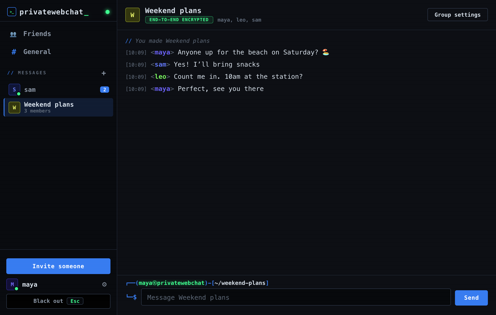

</div>

---

## Contents

- [What it does](#what-it-does)
- [Screenshots](#screenshots)
- [Themes](#themes)
- [How it works](#how-it-works)
- [Set up your own network](#set-up-your-own-network)
- [Sharing the app (Discord or anything else)](#sharing-the-app-discord-or-anything-else)
- [Building from source](#building-from-source)
- [Tests](#tests)
- [Security: what's protected and what isn't](#security-whats-protected-and-what-isnt)
- [Project layout](#project-layout)
- [FAQ](#faq)

## What it does

| | |
|---|---|
| 💬 **General chat** | One room everyone in the network can read and write in. |
| 👥 **Friends** | Discord-style friend requests by username: send, accept, decline, cancel, remove, block. |
| ✉️ **Direct messages** | A Messages inbox with unread badges. DMs are between friends only. |
| 👨‍👩‍👧 **Group chats** | Make a group with any of your friends; rename it, add people, or leave. |
| 🔔 **Desktop notifications** | Notification Center on Mac and a tray notification on Windows, for DMs, group messages and friend requests while the app is in the background. |
| 🔐 **End-to-end encryption** | The server only ever sees ciphertext. Every message has its own key. |
| 🎟️ **Invite only** | No sign-up and no public rooms. Each invite works for exactly one person. |
| 🏷️ **Permanent usernames** | Usernames are unique and signed into your membership, so they can't be changed or faked. |
| 🔢 **PIN lock** | A PIN on every launch. It also encrypts everything stored on the computer. |
| ⬛ **Black-out key** | One key (Esc by default) turns the window completely black. Only your PIN brings it back. |
| 🧨 **Wipe PIN** | A second PIN that erases everything on the computer and leaves the app looking freshly installed. |
| 🎨 **Themes** | Kali (default), Matrix, Amber and Midnight, under Settings → Appearance. |
| 🪶 **Tiny** | Written in C on top of the system's own web view: about 150 KB on Mac. |

There's no profanity filter or moderation layer: privatewebchat is meant for a private group of friends, not the public.

## Screenshots

<table>
<tr>
<td width="50%">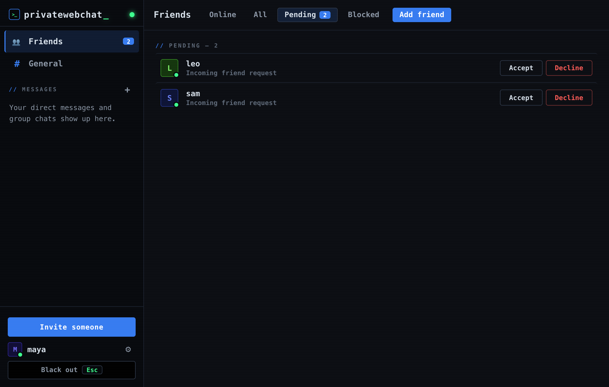<br><sub><b>Friend requests.</b> Pending requests wait here with Accept and Decline.</sub></td>
<td width="50%">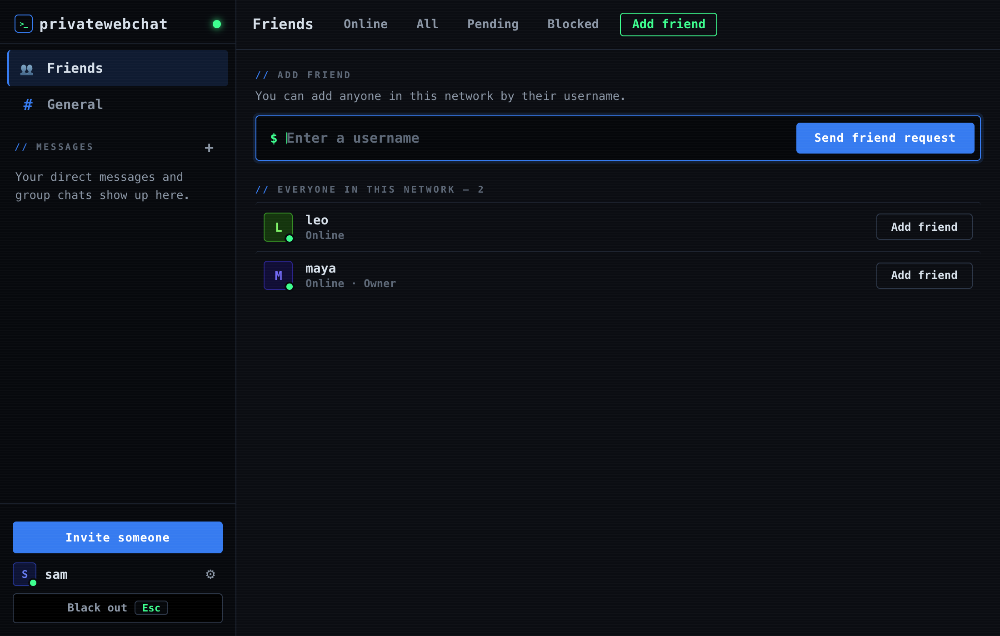<br><sub><b>Add friend.</b> Type a username, or pick someone from the network.</sub></td>
</tr>
<tr>
<td>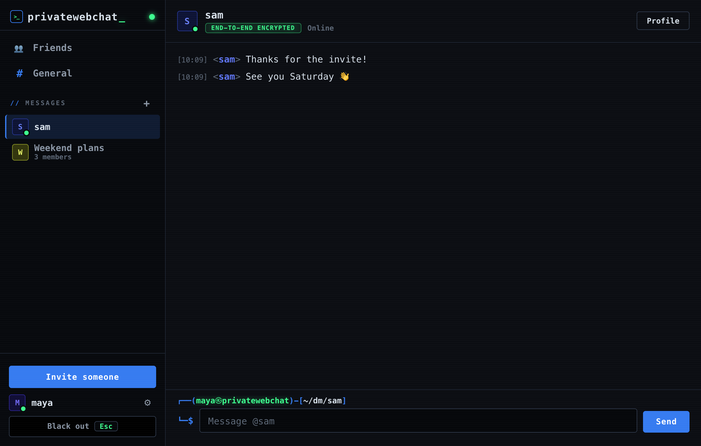<br><sub><b>Direct messages.</b> Only the two of you can read them.</sub></td>
<td>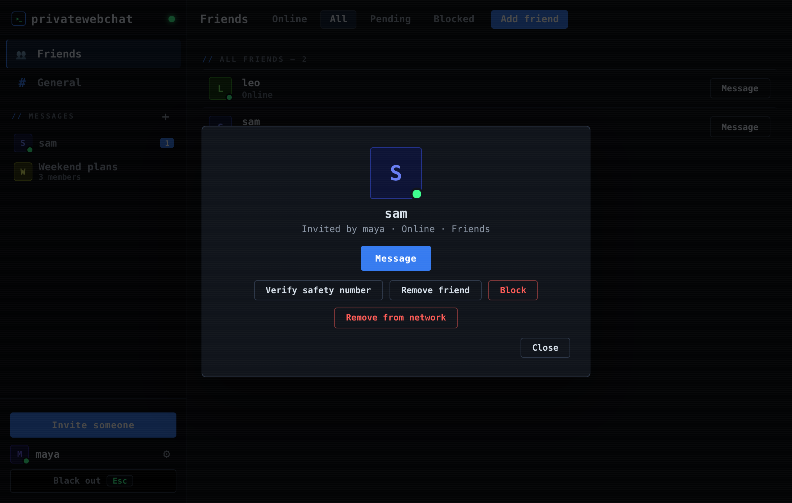<br><sub><b>Profiles.</b> Click any name to message, verify, unfriend or block.</sub></td>
</tr>
<tr>
<td>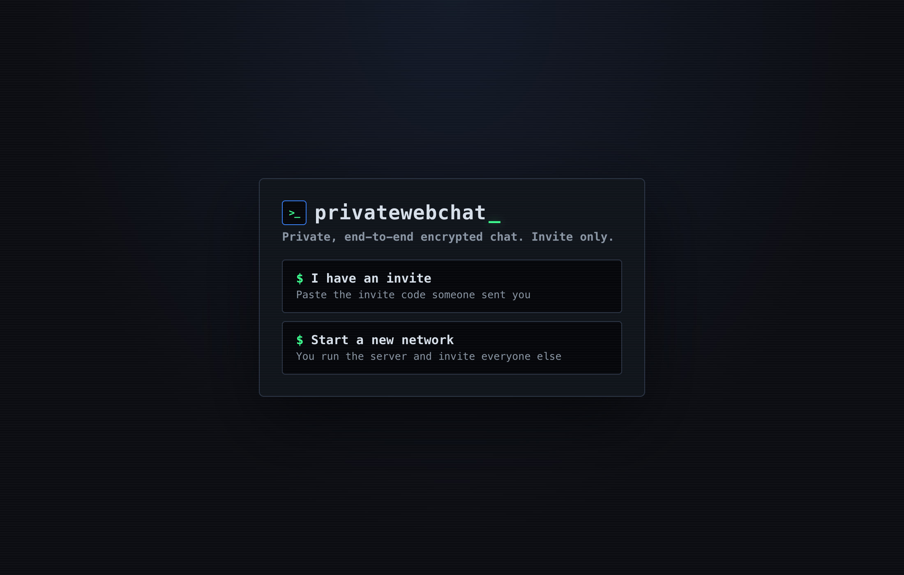<br><sub><b>First run.</b> Join with an invite, or start your own network.</sub></td>
<td>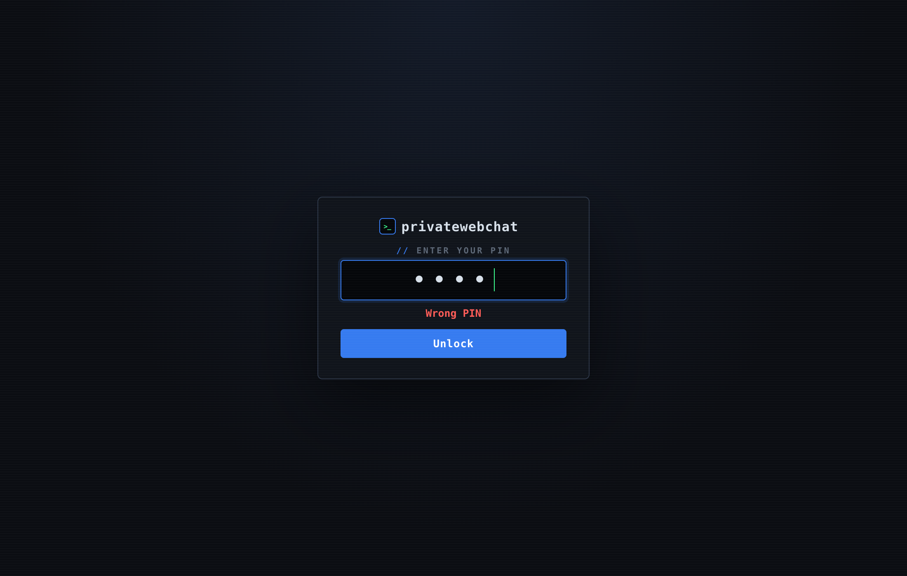<br><sub><b>PIN on every launch.</b> Five wrong tries start a growing delay.</sub></td>
</tr>
</table>

### The black-out key and the wipe PIN

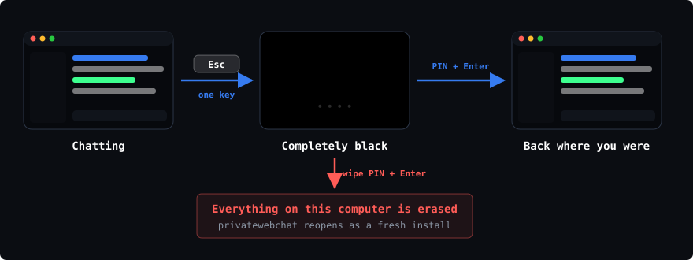

- Press the key you chose and the whole window turns black instantly: no text, no cursor, no hint that it's a chat app. Notifications stop while it's black.
- To come back, type your PIN and press **Enter**. Nothing is shown while you type.
- Optionally, the key also works while the app is in the background (Settings → *Also works when privatewebchat is in the background*). Pick a key you don't use elsewhere, like F9.
- Typing the **wipe PIN** instead, here or on the lock screen, erases your identity, every message and all settings. The app then opens like a fresh install. The saved data doesn't reveal whether a wipe PIN is set.

## Themes

Pick one in **Settings → Appearance**. Your choice is remembered, even on the lock screen.

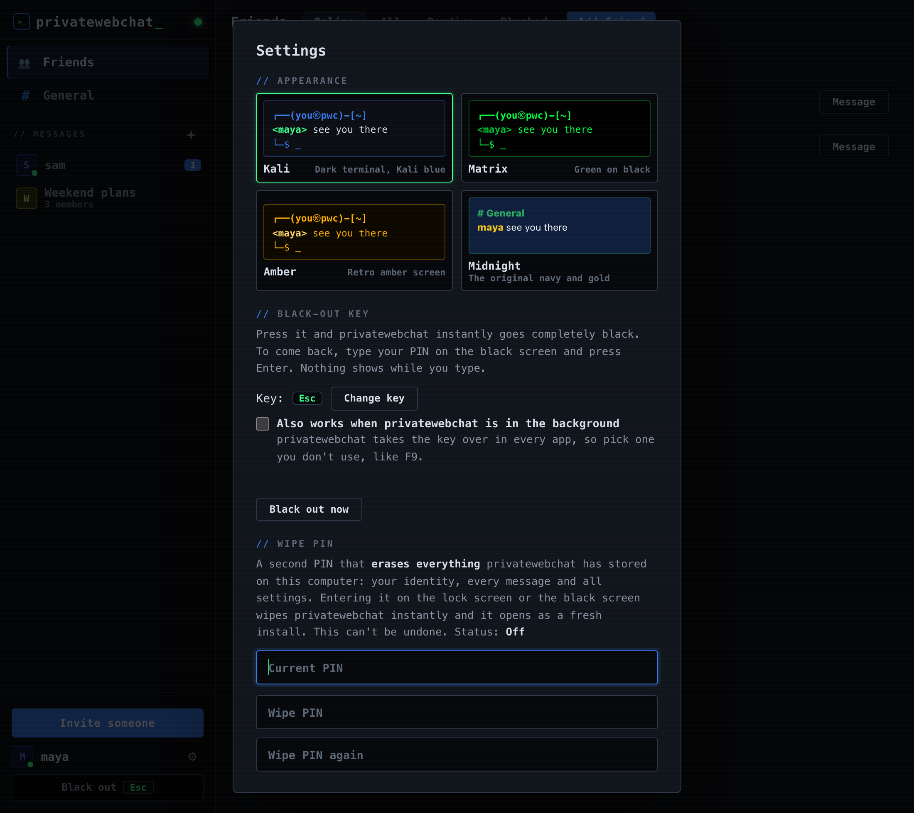

<table>
<tr>
<td width="33%">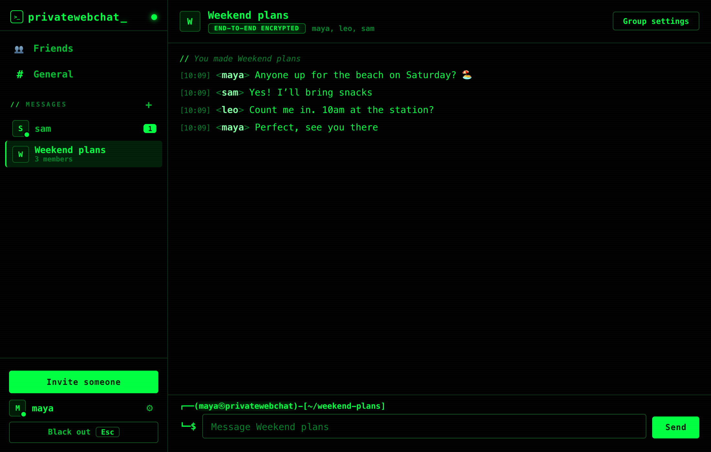<br><sub><b>Matrix.</b> Green on black.</sub></td>
<td width="33%">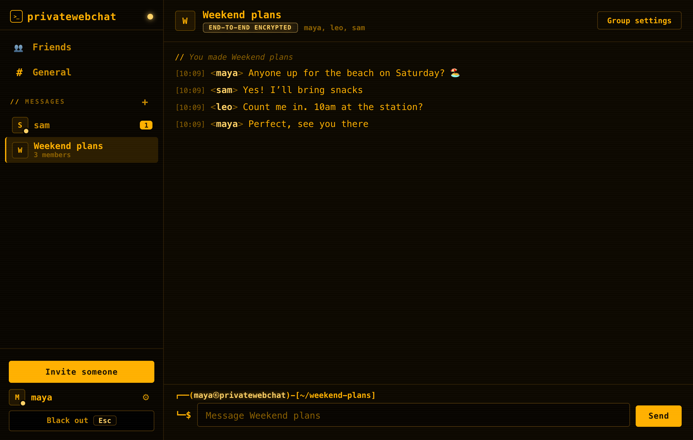<br><sub><b>Amber.</b> A retro amber screen.</sub></td>
<td width="33%">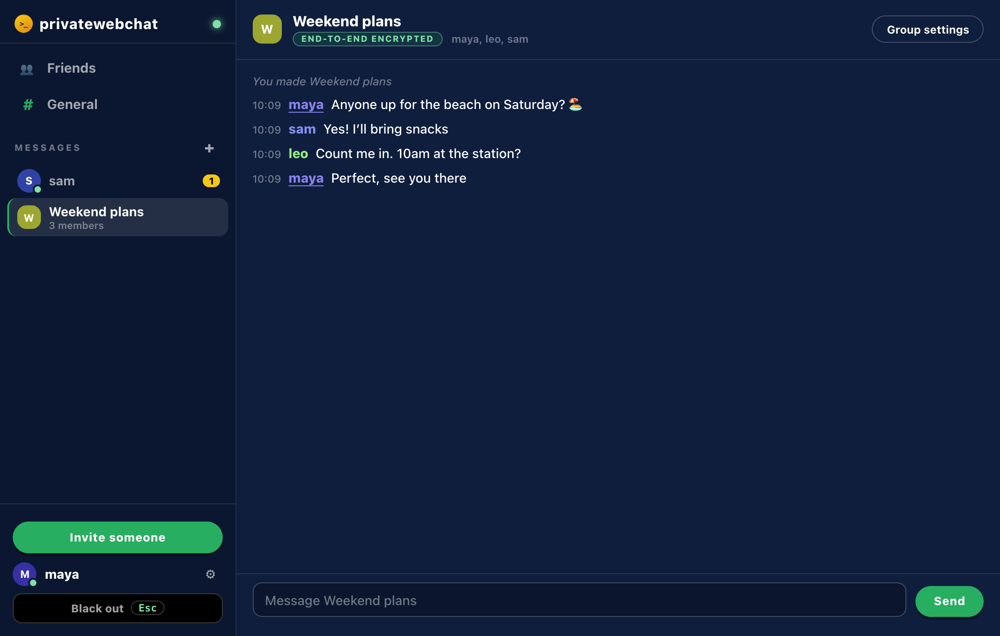<br><sub><b>Midnight.</b> The original navy and gold.</sub></td>
</tr>
</table>

The terminal themes (Kali, Matrix, Amber) use IRC-style lines (`[10:06] <maya> …`) and a Kali zsh-style prompt above the message box: `┌──(maya㉿privatewebchat)-[~/weekend-plans]`.

## How it works

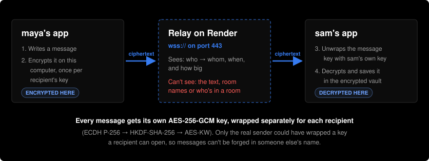

The **app** is a small C program that opens the system's built-in web view (WKWebView on Mac, WebView2 on Windows) and serves its UI to it from `127.0.0.1`. All the encryption happens in that UI with the browser's WebCrypto: **ECDH P-256 → HKDF-SHA-256 → AES-KW** to wrap a fresh **AES-256-GCM** key for every message. It's the same scheme as the EduArcade chatboard, but with lasting identities.

The **server** is a Node relay on Render, reached over `wss://` on port 443. It forwards encrypted envelopes and holds them for people who are offline. It keeps nothing on disk by default.

### Invite only, without a database

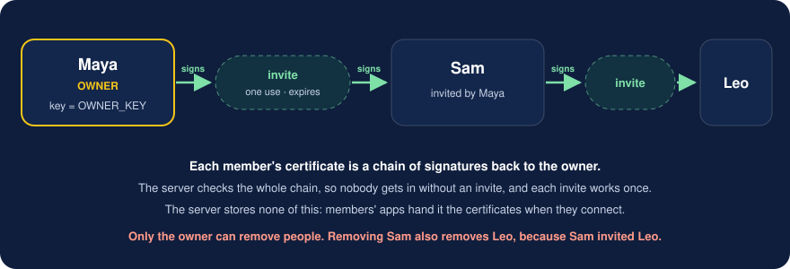

Membership is a chain of signatures. The owner's public key is the server's `OWNER_KEY`. An invite is a one-time key the inviter signs, and joining signs your identity with it. The server checks the whole chain on every connection. Members' apps hand the server what it needs when they connect, so a free Render instance that restarts and forgets everything still knows exactly who's allowed in.

Friend requests, group chat names and member lists are all encrypted messages too, so the server never learns who's friends with whom.

## Set up your own network

You need a free [Render](https://render.com) account and a GitHub account.

### 1. Deploy the server

1. Fork or copy this repo.
2. In Render, choose **New → Blueprint** and pick the repo. `render.yaml` sets everything up.<br>
   To set it up by hand instead, create a **Web Service** with build command `cd server && npm ci` and start command `node server/index.js`.
3. Leave `OWNER_KEY` empty for now. Your address will be something like `your-privatewebchat.onrender.com`.

### 2. Get the app

Download it from this repo's **Releases** page, or [build it](#building-from-source).

### 3. Start the network

Open privatewebchat and choose **Start a new network**. Enter your Render address, pick a username (it can't be changed later) and set a PIN. The app then shows your **OWNER_KEY**:

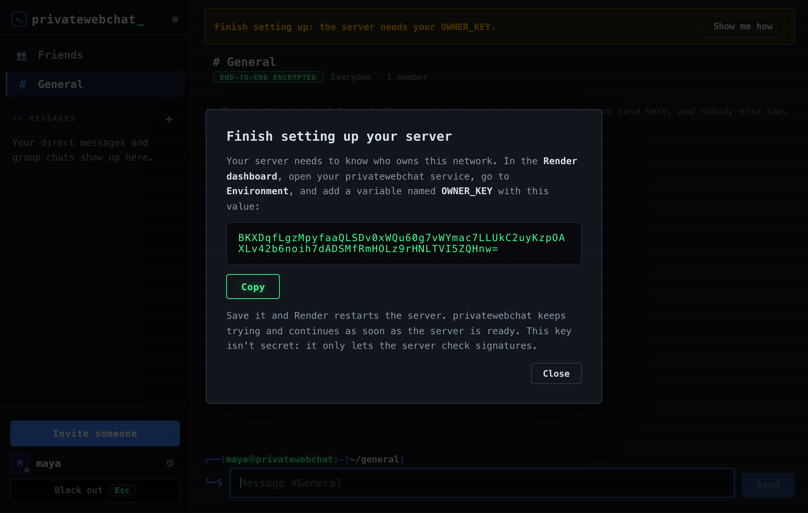

In Render, open the service, go to **Environment**, add `OWNER_KEY` with that value, and save. Render restarts the server, and the app connects by itself as soon as it's ready.

### 4. Invite your friends

Click **Invite someone**, pick how long the invite lasts (1 hour, 24 hours or 7 days) and send the code (it starts with `PWC1.`) to one person privately. They install privatewebchat, choose **I have an invite**, paste it, and pick their username.

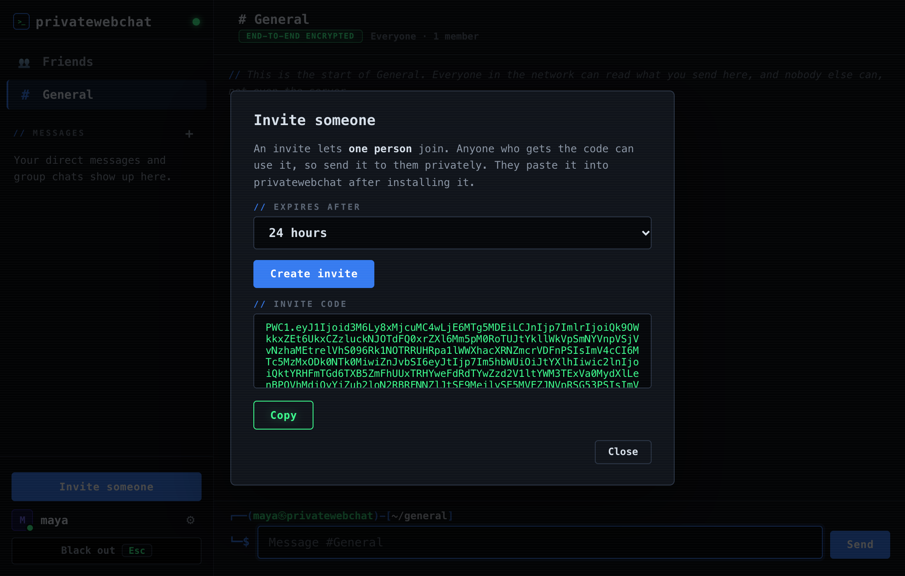

### 5. Add friends

Everyone lands in **General**. To DM someone or put them in a group chat, add them as a friend: **Friends → Add friend**, then type their username.

## Sharing the app (Discord or anything else)

Each download is a single small file, well under Discord's upload limit: `privatewebchat-mac.zip` (about 150 KB) and `privatewebchat.exe` (a few MB). The apps aren't code-signed, so the first launch shows a warning:

- **Mac:** unzip, then right-click **privatewebchat.app → Open → Open**. On newer macOS: *System Settings → Privacy & Security → Open Anyway*. Allow notifications when asked.
- **Windows:** in the SmartScreen warning, click **More info → Run anyway**. The app uses the Microsoft Edge WebView2 Runtime, which Windows 10 and 11 normally already have. If it's missing, the app shows the download link.

Signing (an Apple Developer ID and a Windows code-signing certificate) would remove the warnings.

## Building from source

| Platform | Command | Output |
|---|---|---|
| Mac | `app/build-mac.sh` (needs `xcode-select --install`) | `app/dist/privatewebchat-mac.zip` (universal: Apple Silicon and Intel) |
| Windows | `app\build-windows.bat` from the *x64 Native Tools Command Prompt* (Visual Studio Build Tools) | `app\dist\privatewebchat.exe` |
| Windows, built on a Mac or Linux | `brew install mingw-w64`, then `app/build-windows.sh` | `app/dist/privatewebchat.exe` |

**GitHub Actions** (`.github/workflows/build.yml`) builds both apps and runs every test on each push to `main`. To publish a release with both downloads attached:

```sh
git tag v1.0.0
git push origin v1.0.0
```

## Tests

```sh
cd server && npm ci && cd ..
node tests/protocol.test.js   # certificates, invites, removals, encryption
node tests/server.test.js     # the relay end to end: invites, unique usernames, delivery, restarts
node tests/ui/run.js          # three people use the real UI in headless Chrome (needs Google Chrome and Node 22+)
app/tools/selftest.sh         # Mac: checks WebCrypto, bindings and WebSocket inside the real app window
```

The UI test plays out a whole session: setting up a network, invites (including reusing one and taking an existing username), General, friend requests, DMs with desktop notifications, group chats, themes, the black-out key, the lock screen, the wipe PIN and removing a member. It also takes the screenshots in this README.

## Security: what's protected and what isn't

**Protected**
- **Message contents**, plus room names, group members and friendships. These are encrypted on your computer, and the server can't read them.
- **Sender authenticity.** Only the real sender can wrap a key that you can open, so messages can't be forged in someone else's name.
- **Membership.** No valid invite chain, no entry. Each invite is single-use and expires.
- **Data at rest.** One AES-GCM vault, keyed with PBKDF2 (600,000 rounds) over your PIN plus a device secret kept in the Mac Keychain or Windows DPAPI. A copied vault file can't be cracked elsewhere, and wiping deletes the device secret, so even a recovered copy stays unreadable.
- **Key verification.** Safety numbers (*Profile → Verify safety number*) let two people check in person that the server hasn't swapped anyone's keys.

**Visible to the server:** who sends to whom, when, and how big each message is. Also IP addresses (to Render).

**Visible on the computer without the PIN:** only your chosen theme, so the lock screen can use it.

**Things to know**
- Anyone who gets an **unused** invite code can join with it. Send codes privately.
- Only the owner can remove members, and removing someone also removes everyone they invited.
- If the owner's app is wiped, the network keeps working, but nobody can remove members anymore. Starting over means setting a new `OWNER_KEY` and re-inviting everyone.
- People who join later can't read messages sent before they joined.
- Each identity lives on one computer. A forgotten PIN means asking for a new invite.
- Render's free plan sleeps when idle and keeps nothing on disk, so messages waiting for someone offline are lost if it restarts. A paid instance with a disk and `DATA_DIR=/var/data` keeps them.

## Project layout

```
app/
  src/            C: main.c (window, local UI server, bindings), platform_mac.c, platform_win.c, embed.c
  ui/             The interface: index.html, style.css (themes), app.js, vault.js (encrypted storage), protocol.js (crypto)
  vendor/webview/ webview library (MIT)
  build-mac.sh, build-windows.bat, build-windows.sh, tools/selftest.sh
server/           Node relay for Render (index.js); shares app/ui/protocol.js
tests/            protocol, server and UI tests
docs/images/      README images
render.yaml       Render blueprint
```

## FAQ

**Why C instead of Electron?** Size. An Electron app is over 100 MB; privatewebchat is about 150 KB on Mac because it uses the web view the OS already has.

**Can I change my username?** No. It's part of your signed membership certificate, which is what lets everyone trust that `sam` is really sam. Pick carefully.

**Do I have to be friends to talk?** Not in General. DMs and group chats are for friends only.

**What happens if the server restarts?** Everyone reconnects automatically and the server re-learns the network from members' apps. Only messages still waiting for offline people are lost (see above).

**Is there moderation or a word filter?** No, by design. The owner can remove members, and anyone can block anyone.

---

<sub>Built on [webview](https://github.com/webview/webview) (MIT). Encryption design adapted from the EduArcade chatboard.</sub>
